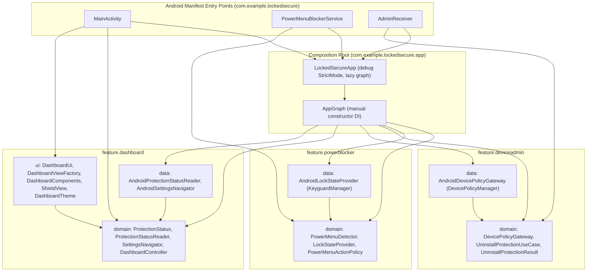

# LockedSecure — Architecture

LockedSecure is a single-module (`:app`), zero-third-party-dependency Android utility organized **by feature** with strict **Clean Architecture** layering (`ui` → `domain` ← `data`) enforced automatically on every test run by `ArchitectureBoundaryTest`.

---

## 1. High-Level Diagram

---

## 2. Package & Responsibility Map

| Package | Layer | Responsibility | Allowed Dependencies |
|---|---|---|---|
| `com.example.lockedsecure` | Entry points | Thin Android manifest components (`MainActivity`, `PowerMenuBlockerService`, `AdminReceiver`) kept at root package for upgrade compatibility | `app`, feature `domain`, feature `ui` |
| `com.example.lockedsecure.app` | Composition root | `LockedSecureApp` (zero work in release `onCreate`; `StrictMode` in debug) and `AppGraph` (lazy manual constructor DI) | Feature `domain` + `data` |
| `feature.powerblocker.domain` | Domain | Pure Kotlin power-menu detection (`PowerMenuDetector`) and lock-screen gating (`PowerMenuActionPolicy`) | Pure Kotlin only (zero `android.*`) |
| `feature.powerblocker.data` | Data | `AndroidLockStateProvider` wrapping `KeyguardManager` | `powerblocker.domain`, Android SDK |
| `feature.deviceadmin.domain` | Domain | Pure Kotlin Device Owner uninstall-protection orchestration (`UninstallProtectionUseCase`, `UninstallProtectionResult`) | Pure Kotlin only (zero `android.*`) |
| `feature.deviceadmin.data` | Data | `AndroidDevicePolicyGateway` wrapping `DevicePolicyManager` | `deviceadmin.domain`, Android SDK |
| `feature.dashboard.domain` | Domain | `ProtectionStatus`, `ProtectionStatusReader`, `SettingsNavigator`, `DashboardController` | Pure Kotlin only (zero `android.*`) |
| `feature.dashboard.data` | Data | `AndroidProtectionStatusReader` (`Settings.Secure` + `DevicePolicyManager`), `AndroidSettingsNavigator` (Settings intents) | `dashboard.domain`, Android SDK |
| `feature.dashboard.ui` | UI | `DashboardUi` interface, pure Android Views (`DashboardViewFactory`, `DashboardComponents`, `ShieldView`, `DashboardTheme`) | `dashboard.domain`, Android SDK |

---

## 3. Core Data Flows

1. **Power menu interception (background, event-driven):**
   `AccessibilityEvent` → `PowerMenuBlockerService` → `PowerMenuEvent` → `PowerMenuActionPolicy.evaluate()` → `PowerMenuDetector.isPowerMenu()` → (only if matched) `AndroidLockStateProvider.isDeviceLocked()` → `BLOCK_AND_DISMISS` → `performGlobalAction(GLOBAL_ACTION_BACK)`.
   *Zero work runs when idle; no polling, no background services beyond the OS-bound AccessibilityService, no wake locks.*

2. **Uninstall protection activation (event-driven broadcast):**
   `DEVICE_ADMIN_ENABLED` → `AdminReceiver.onEnabled()` → `UninstallProtectionUseCase.activateIfDeviceOwner()` → `AndroidDevicePolicyGateway.isDeviceOwner()` → `setUninstallBlocked(true)` → typed `UninstallProtectionResult` → Toast feedback.

3. **Dashboard render & settings navigation (foreground only):**
   `MainActivity.onResume()` → `DashboardController.loadStatus()` → `AndroidProtectionStatusReader.readStatus()` → `DashboardUi.render(status)`.
   Button tap → `DashboardController.onPowerBlockerAction()` / `onAdminProtectionAction()` → `AndroidSettingsNavigator` → `NavigationResult.Opened` or `NavigationResult.Unavailable` (Toast fallback).

---

## 4. Automated Architecture Enforcement

`app/src/test/java/com/example/lockedsecure/ArchitectureBoundaryTest.kt` runs on every `./gradlew test` and fails the build if:
- Any `*.domain` file imports `android.*`, `*.data.*`, or `*.ui.*`
- Any `*.ui` file imports `*.data.*`
- Any feature imports another feature's `data` or `ui` internals
- Any circular package dependency exists
- Any production file exceeds 300 lines, any function exceeds 40 lines, or any `!!`, `lateinit`, or wildcard import is introduced

---

## 5. Key Architecture Decision Records

- [ADR-0001: Incremental Strangler Migration & Pure Android Framework Views](adr/0001-incremental-strangler-and-native-views.md)
- [ADR-0002: Manual Lazy Dependency Injection (`AppGraph`)](adr/0002-manual-dependency-injection.md)
- [ADR-0003: Deterministic Tag-Derived Versioning & Hardened Release Pipeline](adr/0003-deterministic-versioning-and-release-security.md)
